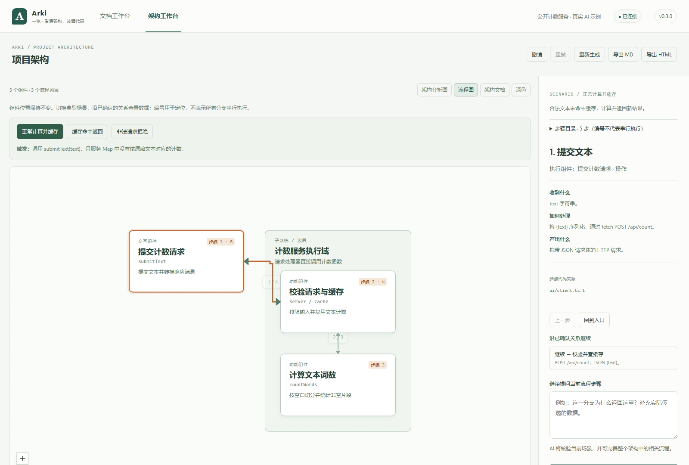

<div align="center">


# Arki

**See the architecture. Understand the code.**

From the whole project, to a request, to its code evidence.

[简体中文](README.md) · [Getting started](docs/getting-started.md) · [Downloads](https://github.com/Inginnng/arki/releases) · [Issues](https://github.com/Inginnng/arki/issues)

[](https://github.com/Inginnng/arki/actions/workflows/ci.yml)
[](https://github.com/Inginnng/arki/releases)
[](LICENSE)

</div>

Arki is a local architecture workspace and Codex plugin. It reads implementation code, produces architecture Markdown and interactive diagrams, and lets you ask questions about components and relationships with code evidence.

Use it to explore an unfamiliar codebase, understand a legacy system, follow a request, or prepare architecture notes that remain useful after the first conversation. The current UI is primarily Chinese.



*The screenshot uses a public text-counting example analyzed by a real model. It is an example, not a claim of complete coverage for arbitrary projects.*

## One architecture, multiple scenarios

- **Component structure:** nested subsystem boundaries, responsibilities and original code identifiers.
- **Scenario walkthroughs:** the same component positions, with participants and transfers highlighted for a typical operation.
- **Independent steps:** repeated participants, conditions, parallel branches, joins, returns and retries. Step numbers do not imply every branch runs sequentially.
- **Grounded questions:** inspect inputs, processing, outputs and source references; ask the model to improve an unclear part.
- **Continuity:** per-project browser storage, undo/redo, offline reading, and Markdown or script-free HTML exports.
- **Version checks:** manually query official GitHub releases and follow validated release links; no background installation.

Static imports are not automatically treated as runtime flows. Diagram layout failures retain readable components, steps and transfers.

## Quick start

**The easiest way: ask AI to install Arki.** Copy this prompt into an AI assistant with access to your local terminal, such as Codex:

```text
https://github.com/Inginnng/arki — Help me install Arki.
```

Add your project directory if you want to analyze a specific project. You can also follow the manual steps below.

Requires Node.js 20.19+ (22 LTS recommended) and a signed-in, usable Codex CLI. **Windows with Edge is the primary verified desktop environment.** Complete macOS/Linux live Codex validation remains pending.

Download and extract a ZIP from [Releases](https://github.com/Inginnng/arki/releases), then run inside the extracted directory:

```sh
node dist/arki.mjs --root "/path/to/your/project" --open
```

The archive contains the production application and plugin; installing npm dependencies is not required. Node.js and Codex are not included. On Windows, you can drag a project folder onto the archive's `Arki.cmd`.

To build from source:

```sh
git clone https://github.com/Inginnng/arki.git
cd arki
pnpm install --frozen-lockfile
pnpm build
pnpm start
```

Open the printed URL and choose **一键分析当前项目**. To inspect another directory, run `node scripts/arki.mjs --root "/path/to/project" --open` from the Arki checkout.

For a compatible Codex CLI with plugin support, register the cloned repository using `codex plugin marketplace add .`, then install `codex plugin add aimd-reader@aimd-local`. Restart Codex or open a new task and ask it to use Arki for the current project. The internal plugin ID remains `aimd-reader` for compatibility.

## Data and limitations

The UI and loopback-only backend run locally. **AI requests send selected source excerpts and questions to your configured Codex service.** Local operation does not mean offline AI inference. Arki has no hosted analysis service of its own.

The architecture workspace does not edit source code. The separate reviewed-document workflow can create a sibling `*.explained.md` only after approval of an exact diff; original Markdown is never overwritten.

Analysis is bounded and does not prove complete architecture coverage or runtime behavior. The architecture workspace uses project evidence and does not claim verified inheritance of the active Codex task. Deterministic tests and public live examples are not general model-accuracy measurements.

Saved work belongs to the current browser origin. Clearing site data removes it; different browsers or ports do not share it. Export important analyses. See [security](SECURITY.md), [capabilities](docs/capability-report.md), and [updates](docs/updates.md).

## Contribute

Bug reports, public fixtures, documentation improvements and focused pull requests are welcome in English or Chinese. Start with [CONTRIBUTING.md](CONTRIBUTING.md), the [development guide](docs/development.md), [roadmap](docs/roadmap.md), or [issue templates](https://github.com/Inginnng/arki/issues/new/choose).

## Acknowledgments

Built with [React Flow](https://github.com/xyflow/xyflow), [ELK.js](https://github.com/kieler/elkjs), and a vendored [Archify compatibility renderer](third_party/archify/NOTICE.md). Thank you to their contributors.

Licensed under [MIT](LICENSE); dependencies retain their own licenses in [Third-party notices](THIRD_PARTY_NOTICES.md). Arki is an independent community project and is not affiliated with OpenAI. It was previously named AIMD Reader; internal `@aimd/*` identifiers remain for compatibility.
