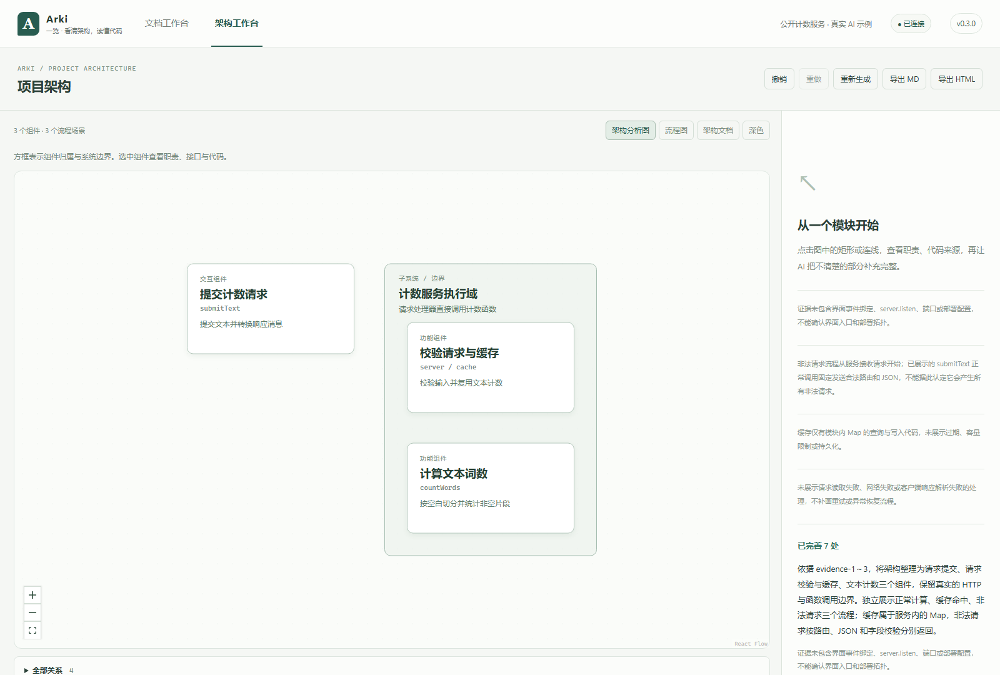

<div align="center">


# Arki · 一览

**看清架构，读懂代码。**

从项目全貌，到一条请求，再到一行证据。

[English](README.en.md) · [快速开始](docs/getting-started.md) · [使用指南](docs/user-guide.md) · [下载](https://github.com/Inginnng/arki/releases) · [反馈](https://github.com/Inginnng/arki/issues)

[](https://github.com/Inginnng/arki/actions/workflows/ci.yml)
[](https://github.com/Inginnng/arki/releases)
[](LICENSE)

</div>

Arki 是一个本地项目架构工作台，也是一个 Codex 插件。它阅读实现代码，生成架构 Markdown、可交互的组件图和典型流程；你可以点击组件或连线追问，并沿着代码证据理解答案。

适合接手陌生代码、梳理遗留系统、理解一次请求的完整过程，以及为团队准备可继续阅读的架构说明。


*截图使用公开的文本计数示例。场景由真实 AI 分析生成，不代表所有项目都会得到相同覆盖度。*

## 一张底图，两种阅读方式

| 架构分析图 | 流程图 |
| --- | --- |
| 查看子系统、组件职责和归属 | 选择正常操作、缓存命中、异常处理等典型场景 |
| 大框嵌套小框，保留原始代码标识 | 组件位置保持不变，突出参与者与数据传递 |
| 从组件进入代码和问答 | 逐步阅读输入、处理、输出、条件和来源 |

同一组件可以参与多个步骤。分支、并行、合流、返回与重试有独立表达，数字不是简单的串行序号。静态依赖不会被自动当成运行流程。

## 能做什么

- **有证据的架构理解**：先阅读实现，再组织职责和具体的数据传递；可继续追问不清楚的部分。
- **交互式阅读**：选择组件、子系统、步骤或关系，查看来源并让 AI 完善分析。
- **回来继续**：按项目保存图与已完成问答，支持撤销、重做和离线阅读。
- **整理项目文档**：挑选需要的 Markdown，也可导入本地文档。
- **随时导出**：MD 与无脚本 HTML 保留全部场景、步骤和证据来源。
- **明确的更新入口**：按需检查 GitHub 正式版，查看说明与下载，不后台安装。

## 快速开始

**最简单：让 AI 帮你安装。** 将下面这句话复制给能操作本机终端的 AI 助手（例如 Codex）：

```text
https://github.com/Inginnng/arki，帮我安装 Arki。
```

想指定要分析的项目，再补充项目目录即可。也可以按下面的步骤手动安装。

需要 Node.js 20.19+（建议 22 LTS）和已登录的 Codex。**Windows + Edge 是当前主要实测环境**；macOS/Linux 的完整 Codex 联调仍待验证。

从 [Releases](https://github.com/Inginnng/arki/releases) 下载 ZIP，解压后运行：

```sh
node dist/arki.mjs --root "你的项目目录" --open
```

Windows 可将项目文件夹拖到发行包内的 `Arki.cmd`。发行包已包含生产资源，无需 `pnpm install`；Node.js 和 Codex 仍需自行安装。

从源码运行：

```sh
git clone https://github.com/Inginnng/arki.git
cd arki
pnpm install --frozen-lockfile
pnpm build
pnpm start
```

打开启动器输出的地址，点击「一键分析当前项目」。分析其他目录、安装 Codex 插件和首次使用步骤见 [快速开始](docs/getting-started.md)。

## 一次典型使用

1. 打开项目，生成架构分析。
2. 先看组件职责，再选择一个典型场景。
3. 问：“这里传的是什么数据？”“为什么会走到这个分支？”
4. 打开对应代码，核对解释。
5. 导出文档，或下次从原来的浏览器地址继续阅读。



## 本地运行与当前边界

浏览器和后台运行在本机，后台只绑定 `127.0.0.1`。**AI 分析会将选定的代码片段与问题发送到你配置的 Codex 服务**，因此本地运行不等于离线推理。Arki 没有自己的托管分析服务。

架构工作台不修改源码。独立的文档审核流程只有在精确 diff 获得批准后，才能创建新的 `*.explained.md`，原 Markdown 不覆盖。

分析不是完整程序证明或运行时追踪。大型项目的扫描和证据读取有上限，未确认环节会保留说明。当前架构分析使用项目证据；精确继承当前 Codex 任务仍依赖可信宿主支持。测试通过不代表一般模型准确率已经建立。

存档在当前浏览器内，清理站点数据会删除它；不同浏览器和端口不共享存档。建议导出重要分析。详见 [安全说明](SECURITY.md) 与 [能力报告](docs/capability-report.md)。

## 文档与参与

| 使用 | 开发 |
| --- | --- |
| [文档索引](docs/README.md) | [贡献指南](CONTRIBUTING.md) |
| [更新与回退](docs/updates.md) | [开发与测试](docs/development.md) |
| [常见问题](docs/troubleshooting.md) | [内部架构](docs/architecture.md) |
| [变更记录](CHANGELOG.md) | [发布流程](docs/releasing.md) |
| [路线图](docs/roadmap.md) | [报告问题](https://github.com/Inginnng/arki/issues/new/choose) |

欢迎提交可复现的问题、公开示例、文档修正与改进 PR。中文和 English 都可以。

## 致谢与许可

Arki 的交互画布使用 [React Flow](https://github.com/xyflow/xyflow)，布局使用 [ELK.js](https://github.com/kieler/elkjs)，兼容渲染保留 [Archify](third_party/archify/NOTICE.md) 的实现与许可。感谢这些项目的贡献者。

[MIT](LICENSE) · 第三方组件保留各自许可，见 [Third-party notices](THIRD_PARTY_NOTICES.md)。Arki 为独立社区项目，不隶属于 OpenAI。早期名称为 AIMD Reader；内部 `@aimd/*` 和 `aimd-reader` 标识为兼容保留。
